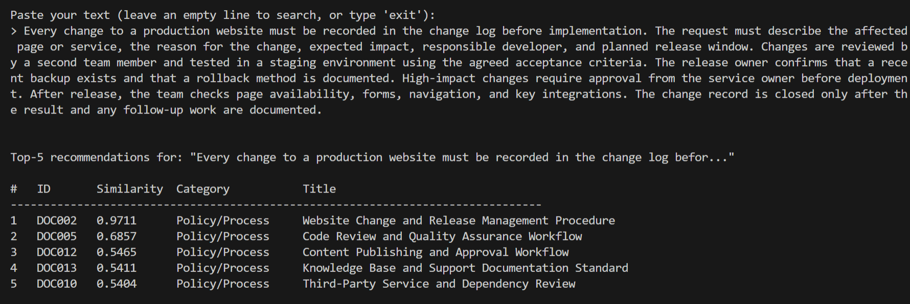
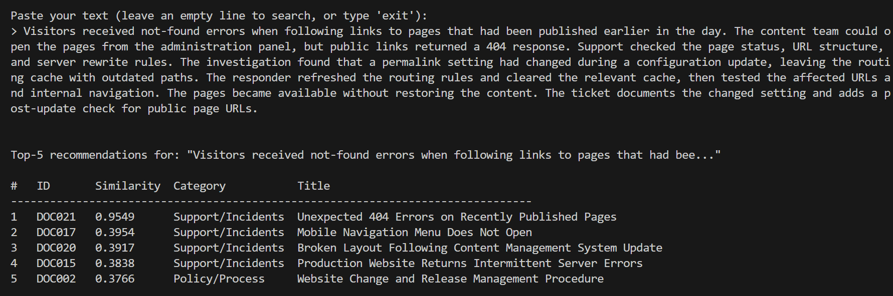
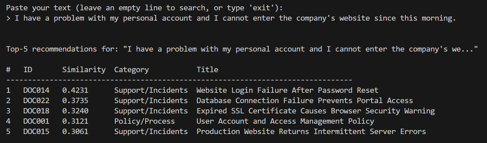

# Evidencias

Evidence from the console showing the results of the embedding recommender:

### Policy/Process

For a complete input of a policy/process document, the recommender returns the original document as the top recommendation as expected, while other similar documents are ranked below it corresponding to the same category. This behavior demonstrates that the recommender effectively identifies and prioritizes documents that are most relevant to the input.

### Support/Incidents

Entering a full support/incident document as input, the recommender gives the top recommendation to the original document. In this case, the last top-5 result was from a different category, indicating that the system can distinguish between documents of varying relevance and categories.

### Free text

When a free text query is provided, the recommender identifies and ranks the most relevant documents from the corpus based on similarity. This demonstrates the system's ability to handle arbitrary text inputs effectively. The input being about _account problems_ correctly match documents related to account issues, database or browser failures, and access management policies.

